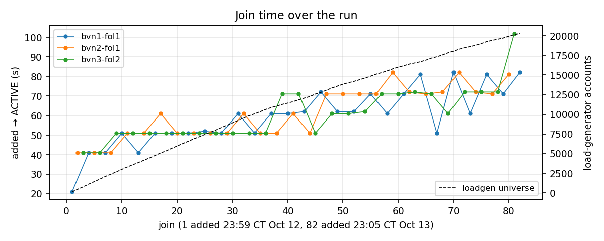
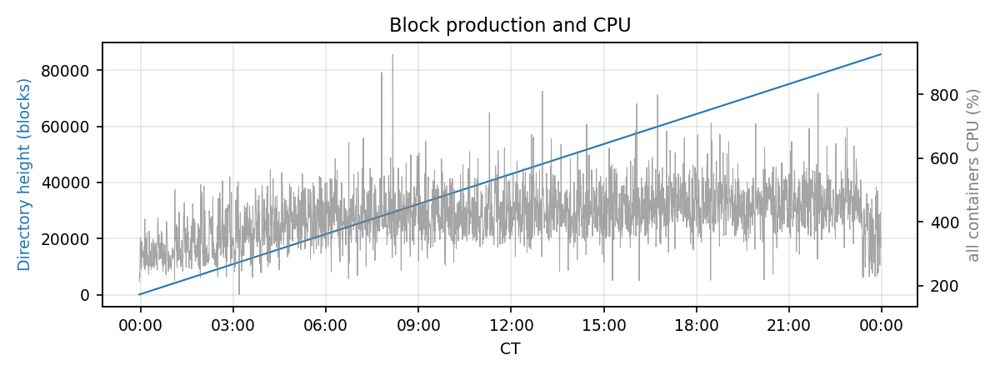
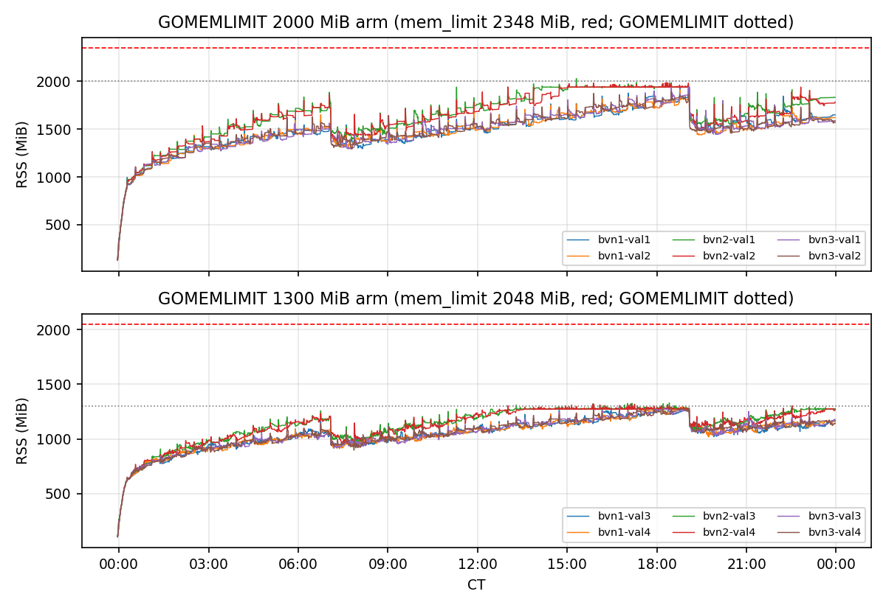
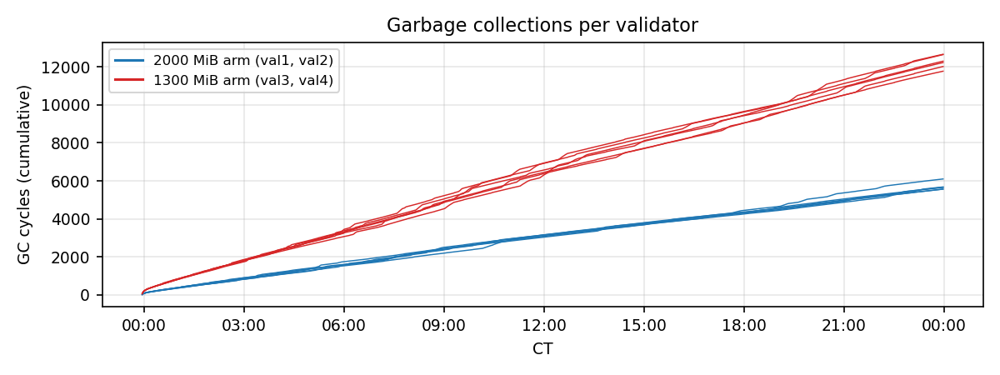
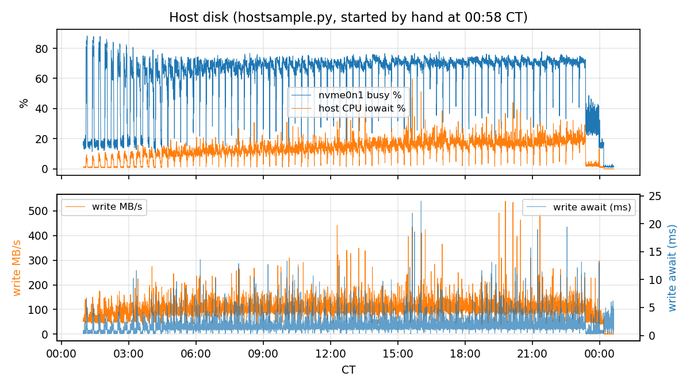

# Verdict

**The bar is met.** Every one of the 82 followers bootstrapped against the running network reached ACTIVE on both of its partitions within two minutes (bar: one hour), held ACTIVE for the whole 15-minute measurement window, and neither the join time nor the lag behind the validators degraded over the 24 hours beyond what the growing load-generator universe accounts for. The validators ran the full day without an out-of-memory kill, a GC thrash, a wedge, a delivery stall or a heal.

| criterion (#4559 / join-acceptance) | result |
|---|---|
| follower syncs within an hour | 82 of 82; added → ACTIVE 21–102 s, median 61 s |
| every section loaded within an hour | 82 of 82; ≤ 1.6 min |
| holds ACTIVE under load | 0 of 7,380 polls not ACTIVE; worst behind 1 block (BVN), 2 blocks (Directory) |
| no degradation over 24 h | join time grew 41 s (first ten) → 77 s (last ten), tracking the universe 131 → 20,305 accounts; lag flat at ≤ 1 block |
| network undisturbed | 0 heals, 0 wedge captures, 0 delivery-stall captures, 0 reconcile pulls, 0 stalled channels at the end |
| memory | no OOM, no GC thrash; both GOMEMLIMIT arms stayed under their container limits |

What this run does **not** show: 10 tps (the issue text named the 10 tps conf; this ran at 5), any disturbance (nothing was paused, restarted or killed), and history older than 24 hours — a follower joining a network with weeks of blocks was not measured.

# Setup

| field | value |
|---|---|
| code | `dagbft-integration` at `6daa4fd48` (branch `test-4530-4542`), executor v2-kourou |
| topology | 3 BVNs × 4 validators, Directory on all 12; one follower (`bvn3-fol1`) launched with the network; three late followers (`bvn1-fol1`, `bvn2-fol1`, `bvn3-fol2`) started one at a time by the walk |
| storage | BlockchainDB (`docker-network.yml`); 1 s blocks |
| load | 5 tps mixed transactions, 100 bootstrap accounts; 454,781 generated, 0 rejected, 5.26 tps achieved |
| walk | `24h-5tps-followers.conf`: databases cleared, follower started, up to 1800 s to ACTIVE on every partition, held 900 s under measurement, removed; round-robin bvn1 → bvn2 → bvn3; first add 2 min in |
| memory A/B (the compose) | val1/val2 of each BVN: GOGC 200, GOMEMLIMIT 2000 MiB, mem_limit 2348 MiB; val3/val4 and followers: GOMEMLIMIT 1300 MiB, mem_limit 2048 MiB; restart policy `no` |
| recorded | per node every 30 s: RSS, heap, next GC, GC count, CPU seconds, goroutines (`mem.csv`); block heights per node/partition (`monitor.csv`); follower lag (`follower.csv`); host disk and CPU every 10 s (`hostsample.csv`); hourly heap, 30 s CPU, goroutine and block profiles plus metrics from every node (23 sets, 757 MB) |
| host | thelio, shared NVMe `nvme0n1`; the weekly fstrim (Mondays ~00:20 CT) did not fall in the window |

# Joins

82 joins, 82 PASS. Each join is a fresh database: the follower pulls the state, matches the validators' root and BPT, is declared ACTIVE when it executes in agreement on both partitions, then fills the remaining sections in the background.

| | bvn1-fol1 | bvn2-fol1 | bvn3-fol2 |
|---|---|---|---|
| joins | 28 | 27 | 27 |
| added → ACTIVE, min / median / max (s) | 21 / 61 / 82 | 41 / 61 / 82 | 41 / 61 / 102 |
| worst behind during the hold, BVN / Directory (blocks) | 1 / 1 | 1 / 2 | 1 / 1 |
| polls not ACTIVE | 0 | 0 | 0 |

The join time climbs about 10 s for every 2,500 accounts the load generator adds to its universe (131 at join 1, 20,305 at join 82): the state pull is proportional to the account set, not to the chain's height (85,674 Directory blocks at the end). The three BVNs are indistinguishable. The one 102 s join (81, bvn3-fol2 at 22:47 CT) is the largest; its fill completed at 1.6 min and its hold was clean.

"Filled" (every section loaded, from `joinphases.py`) ran 0.2 min at the start to 1.2–1.6 min at the end, always within a minute of ACTIVE. The full per-join table is in the appendix.

Removals were judged on the 30 s either side: block cadence unaffected on every partition, every time (`manifest.md`, per-event table).

# Validators over the day

The Directory closed 85,674 blocks in 24.01 h (0.99 blocks/s against a 1 s interval). Whole-network container CPU (all 16–17 containers, `docker stats`) ran at a median 419 % of one core, peaking at 926 % during joins. Heals stayed at 0 from the first sample to the last.

## Memory

Both arms of the compose A/B ran the whole day.

| node | arm (GOMEMLIMIT / mem_limit) | RSS hour 1 (median) | RSS hour 24 (median) | RSS peak | GC cycles | CPU s | goroutines peak / end |
|---|---|---|---|---|---|---|---|
| bvn1-val1 | 2000 / 2348 | 944 | 1624 | 1939 | 6,079 | 23,569 | 332 / 292 |
| bvn1-val2 | 2000 / 2348 | 951 | 1613 | 1914 | 5,549 | 21,250 | 344 / 297 |
| bvn1-val3 | 1300 / 2048 | 662 | 1137 | 1289 | 12,238 | 23,369 | 338 / 294 |
| bvn1-val4 | 1300 / 2048 | 665 | 1146 | 1293 | 11,961 | 23,551 | 335 / 293 |
| bvn2-val1 | 2000 / 2348 | 992 | 1827 | 2030 | 5,660 | 24,194 | 344 / 296 |
| bvn2-val2 | 2000 / 2348 | 997 | 1773 | 1987 | 5,635 | 23,642 | 340 / 294 |
| bvn2-val3 | 1300 / 2048 | 684 | 1274 | 1329 | 12,602 | 26,138 | 333 / 291 |
| bvn2-val4 | 1300 / 2048 | 698 | 1249 | 1321 | 11,711 | 24,116 | 340 / 291 |
| bvn3-val1 | 2000 / 2348 | 966 | 1581 | 1940 | 5,643 | 21,845 | 333 / 290 |
| bvn3-val2 | 2000 / 2348 | 969 | 1599 | 1894 | 5,547 | 20,835 | 340 / 295 |
| bvn3-val3 | 1300 / 2048 | 692 | 1143 | 1301 | 12,169 | 23,276 | 333 / 291 |
| bvn3-val4 | 1300 / 2048 | 685 | 1156 | 1294 | 12,587 | 24,014 | 336 / 290 |

RSS in MiB. Reading:

- **The 2000 MiB arm** climbs ~85 MiB/h, then releases 300–400 MiB arm-wide twice (about 07:00 and 19:00 CT) — the pattern of a cache or retention window emptying, not a leak that only a restart would clear. Peaks 1.89–2.03 GiB, under the 2348 MiB container limit by ≥ 300 MiB. The BVN2 pair runs ~250 MiB hotter than BVN1/BVN3 all day.
- **The 1300 MiB arm** reaches its GOMEMLIMIT at about hour 13 and sits on it (≤ 1.33 GiB) for the rest of the day, paying 2.2× the GC cycles (11,700–12,600 vs 5,550–6,080) at roughly the same CPU. That is the GC holding the limit as designed, not thrashing: the executed heights of the two arms never separated and CPU per node differs by < 10 %.
- The RSS alarm in the monitor assumed 2048 MiB for every container, so the 2000 arm's "OOM approaching" lines above ~1.9 GiB were false — #4568.
- Goroutines were flat, 290–344 on every validator.

## Reads

Read-back probe, validators, whole run: 426,034 timed reads, p50 1.7 ms, p95 13.9 ms, p99 59.5 ms, max 1,031.7 ms (one chain read on BVN2 of an entry 16,102 blocks old); 0 failed, 0 timed out. The follower that ran all day (`bvn1-fol1` while present, 32,644 reads of entries it holds): p50 0.3 ms, p95 1.8 ms, 289 failed — those are reads addressed to it in the seconds around its removal. The load generator had 15,537 NotReady answers retried at another endpoint (a joining follower's designed answer) and 0 queries no endpoint would answer.

# Host

`hostsample.py` was started by hand an hour in (#4569: `soak.sh` does not start it), so the first hour has no disk samples.

| | median | max |
|---|---|---|
| nvme0n1 busy | 69 % | 88 % |
| write | 99 MB/s | — |
| write await | 1.5 ms | 24 ms |
| host CPU iowait | 13 % | 60 % |
| host CPU idle | 65 % | — |

The store grew at roughly 7.8 GB/h across the project's volume (read by hand from `docker system df` during the run: ~173 GB at hour 22; the harness does not record volume size). The disk was never the limiter: the 24 ms worst write wait is one sample, and the busy figure's periodic dips are the follower removals.

# Things to know about the record

- `manifest.md` carries a heading "Stopped early by stallkill … monitor unreachable for 120 s" dated 05:00:00Z. The driver had already exited cleanly (exit 0, 24.01 h) at 04:58:03Z; the watchdog then found the monitor gone and tore the project down as it is meant to. The heading is wrong for a run that finished, and `soak.sh` reads it as `stopped_early=stallkill` — filed as a harness defect.
- `seizewatch` printed one SEIZED line at 00:11 CT (16 min in): a synthetic stream BVN2 → Directory with 8 undelivered for 20 polls. Nothing else saw it: 0 delivery-stall captures, 0 stalled channels at the end, 0 heals, and the baseline runs carried the same line. Treated as a watchdog artefact, not a network event.
- The manifest's "follower start rejoined … not established" rows for the three late followers describe their silence after their last removal (the walk removes the container; it is silent by design).
- `headers/votes dropped by validators for a non-committee author` are not measured: those are Debug lines without a module attribute, so this build never emits them (noted in the manifest).
- Raw data (13 GB, mostly `node-logs-live.txt`) lives in `test/docker/soak/runs/20261013T045549Z/` on thelio and is not committed; `manifest.md`, `follower-report.md`, this report and the conf are.

# Follow-ups filed

- **#4568** — the monitor's RSS alarm must read each container's `HostConfig.Memory`; the manifest should report both arms.
- **#4569** — `soak.sh` should start `hostsample.py` itself.
- Manifest "Stopped early" heading after a clean finish — #4570.
- #4559 left open for the decision on 5 vs 10 tps.

\newpage

# Appendix: every join

Added time in CT; "filled" = every section loaded, minutes after the add (`joinphases.py`); worst behind = the largest lag in blocks seen during the 900 s hold; polls at 10 s.

| # | added (CT) | follower | universe | → ACTIVE s | filled min | worst behind BVN / DN | polls not ACTIVE | verdict |
|---|---|---|---|---|---|---|---|---|
| 1 | Oct 12 23:59 | bvn1-fol1 | 131 | 21 | 0.2 | 0 / 0 | 0 of 90 | PASS |
| 2 | Oct 13 00:15 | bvn2-fol1 | 450 | 41 | 0.4 | 1 / 0 | 0 of 90 | PASS |
| 3 | Oct 13 00:32 | bvn3-fol2 | 765 | 41 | 0.4 | 1 / 0 | 0 of 90 | PASS |
| 4 | Oct 13 00:49 | bvn1-fol1 | 1,111 | 41 | 0.4 | 1 / 0 | 0 of 90 | PASS |
| 5 | Oct 13 01:05 | bvn2-fol1 | 1,426 | 41 | 0.4 | 0 / 0 | 0 of 90 | PASS |
| 6 | Oct 13 01:22 | bvn3-fol2 | 1,742 | 41 | 0.4 | 1 / 0 | 0 of 90 | PASS |
| 7 | Oct 13 01:39 | bvn1-fol1 | 2,080 | 41 | 0.4 | 1 / 0 | 0 of 90 | PASS |
| 8 | Oct 13 01:56 | bvn2-fol1 | 2,372 | 41 | 0.5 | 1 / 0 | 0 of 90 | PASS |
| 9 | Oct 13 02:13 | bvn3-fol2 | 2,677 | 51 | 0.5 | 1 / 0 | 0 of 90 | PASS |
| 10 | Oct 13 02:30 | bvn1-fol1 | 2,991 | 51 | 0.5 | 1 / 0 | 0 of 90 | PASS |
| 11 | Oct 13 02:46 | bvn2-fol1 | 3,304 | 51 | 0.5 | 1 / 0 | 0 of 90 | PASS |
| 12 | Oct 13 03:03 | bvn3-fol2 | 3,585 | 51 | 0.5 | 1 / 0 | 0 of 90 | PASS |
| 13 | Oct 13 03:20 | bvn1-fol1 | 3,863 | 41 | 0.5 | 0 / 0 | 0 of 90 | PASS |
| 14 | Oct 13 03:37 | bvn2-fol1 | 4,160 | 51 | 0.5 | 1 / 0 | 0 of 90 | PASS |
| 15 | Oct 13 03:54 | bvn3-fol2 | 4,444 | 51 | 0.5 | 1 / 0 | 0 of 90 | PASS |
| 16 | Oct 13 04:11 | bvn1-fol1 | 4,763 | 51 | 0.6 | 1 / 0 | 0 of 90 | PASS |
| 17 | Oct 13 04:28 | bvn2-fol1 | 5,081 | 61 | 0.6 | 1 / 0 | 0 of 90 | PASS |
| 18 | Oct 13 04:45 | bvn3-fol2 | 5,345 | 51 | 0.6 | 1 / 0 | 0 of 90 | PASS |
| 19 | Oct 13 05:02 | bvn1-fol1 | 5,675 | 51 | 0.5 | 1 / 0 | 0 of 90 | PASS |
| 20 | Oct 13 05:19 | bvn2-fol1 | 5,968 | 51 | 0.6 | 1 / 0 | 0 of 90 | PASS |
| 21 | Oct 13 05:36 | bvn3-fol2 | 6,272 | 51 | 0.6 | 1 / 1 | 0 of 90 | PASS |
| 22 | Oct 13 05:53 | bvn1-fol1 | 6,564 | 51 | 0.6 | 1 / 0 | 0 of 90 | PASS |
| 23 | Oct 13 06:10 | bvn2-fol1 | 6,874 | 51 | 0.6 | 1 / 2 | 0 of 90 | PASS |
| 24 | Oct 13 06:27 | bvn3-fol2 | 7,139 | 51 | 0.6 | 1 / 0 | 0 of 90 | PASS |
| 25 | Oct 13 06:44 | bvn1-fol1 | 7,435 | 52 | 0.6 | 1 / 0 | 0 of 90 | PASS |
| 26 | Oct 13 07:01 | bvn2-fol1 | 7,719 | 51 | 0.6 | 1 / 0 | 0 of 90 | PASS |
| 27 | Oct 13 07:18 | bvn3-fol2 | 7,993 | 51 | 0.6 | 1 / 0 | 0 of 90 | PASS |
| 28 | Oct 13 07:35 | bvn1-fol1 | 8,299 | 51 | 0.6 | 1 / 0 | 0 of 90 | PASS |
| 29 | Oct 13 07:52 | bvn2-fol1 | 8,611 | 51 | 0.6 | 1 / 0 | 0 of 90 | PASS |
| 30 | Oct 13 08:09 | bvn3-fol2 | 8,924 | 51 | 0.7 | 1 / 0 | 0 of 90 | PASS |
| 31 | Oct 13 08:26 | bvn1-fol1 | 9,220 | 61 | 0.7 | 0 / 1 | 0 of 90 | PASS |
| 32 | Oct 13 08:43 | bvn2-fol1 | 9,523 | 61 | 0.7 | 1 / 0 | 0 of 90 | PASS |
| 33 | Oct 13 09:00 | bvn3-fol2 | 9,827 | 51 | 0.7 | 1 / 0 | 0 of 90 | PASS |
| 34 | Oct 13 09:17 | bvn1-fol1 | 10,061 | 51 | 0.7 | 1 / 0 | 0 of 90 | PASS |
| 35 | Oct 13 09:34 | bvn2-fol1 | 10,333 | 51 | 0.7 | 1 / 0 | 0 of 90 | PASS |
| 36 | Oct 13 09:51 | bvn3-fol2 | 10,618 | 51 | 0.7 | 1 / 0 | 0 of 90 | PASS |
| 37 | Oct 13 10:08 | bvn1-fol1 | 10,858 | 61 | 0.7 | 1 / 0 | 0 of 90 | PASS |
| 38 | Oct 13 10:25 | bvn2-fol1 | 11,050 | 51 | 0.8 | 1 / 0 | 0 of 90 | PASS |
| 39 | Oct 13 10:42 | bvn3-fol2 | 11,262 | 71 | 0.8 | 1 / 0 | 0 of 90 | PASS |
| 40 | Oct 13 10:59 | bvn1-fol1 | 11,428 | 61 | 0.8 | 1 / 0 | 0 of 90 | PASS |
| 41 | Oct 13 11:16 | bvn2-fol1 | 11,618 | 61 | 0.8 | 1 / 0 | 0 of 90 | PASS |
| 42 | Oct 13 11:33 | bvn3-fol2 | 11,853 | 71 | 0.9 | 1 / 0 | 0 of 90 | PASS |
| 43 | Oct 13 11:51 | bvn1-fol1 | 12,057 | 62 | 0.8 | 1 / 0 | 0 of 90 | PASS |
| 44 | Oct 13 12:08 | bvn2-fol1 | 12,262 | 51 | 0.8 | 1 / 0 | 0 of 90 | PASS |
| 45 | Oct 13 12:25 | bvn3-fol2 | 12,574 | 51 | 0.8 | 1 / 0 | 0 of 90 | PASS |
| 46 | Oct 13 12:42 | bvn1-fol1 | 12,792 | 72 | 0.9 | 1 / 0 | 0 of 90 | PASS |
| 47 | Oct 13 12:59 | bvn2-fol1 | 13,064 | 71 | 1.0 | 1 / 0 | 0 of 90 | PASS |
| 48 | Oct 13 13:16 | bvn3-fol2 | 13,355 | 61 | 0.9 | 1 / 0 | 0 of 90 | PASS |
| 49 | Oct 13 13:34 | bvn1-fol1 | 13,588 | 62 | 0.8 | 1 / 0 | 0 of 90 | PASS |
| 50 | Oct 13 13:51 | bvn2-fol1 | 13,835 | 71 | 1.0 | 1 / 0 | 0 of 90 | PASS |
| 51 | Oct 13 14:08 | bvn3-fol2 | 14,026 | 61 | 0.9 | 1 / 0 | 0 of 90 | PASS |
| 52 | Oct 13 14:25 | bvn1-fol1 | 14,194 | 62 | 0.9 | 1 / 0 | 0 of 90 | PASS |
| 53 | Oct 13 14:42 | bvn2-fol1 | 14,406 | 71 | 1.0 | 1 / 0 | 0 of 90 | PASS |
| 54 | Oct 13 15:00 | bvn3-fol2 | 14,615 | 62 | 1.0 | 1 / 0 | 0 of 90 | PASS |
| 55 | Oct 13 15:17 | bvn1-fol1 | 14,853 | 71 | 1.0 | 1 / 0 | 0 of 90 | PASS |
| 56 | Oct 13 15:34 | bvn2-fol1 | 15,113 | 71 | 1.2 | 1 / 1 | 0 of 90 | PASS |
| 57 | Oct 13 15:51 | bvn3-fol2 | 15,309 | 71 | 1.0 | 1 / 0 | 0 of 90 | PASS |
| 58 | Oct 13 16:09 | bvn1-fol1 | 15,532 | 61 | 1.0 | 1 / 0 | 0 of 90 | PASS |
| 59 | Oct 13 16:26 | bvn2-fol1 | 15,788 | 82 | 1.3 | 1 / 0 | 0 of 90 | PASS |
| 60 | Oct 13 16:43 | bvn3-fol2 | 16,008 | 71 | 0.9 | 1 / 0 | 0 of 90 | PASS |
| 61 | Oct 13 17:01 | bvn1-fol1 | 16,193 | 71 | 1.0 | 0 / 0 | 0 of 90 | PASS |
| 62 | Oct 13 17:18 | bvn2-fol1 | 16,396 | 72 | 1.4 | 1 / 0 | 0 of 90 | PASS |
| 63 | Oct 13 17:35 | bvn3-fol2 | 16,547 | 72 | 1.0 | 1 / 0 | 0 of 90 | PASS |
| 64 | Oct 13 17:52 | bvn1-fol1 | 16,693 | 81 | 1.2 | 1 / 0 | 0 of 90 | PASS |
| 65 | Oct 13 18:10 | bvn2-fol1 | 16,901 | 71 | 1.1 | 0 / 0 | 0 of 90 | PASS |
| 66 | Oct 13 18:27 | bvn3-fol2 | 17,158 | 71 | 1.0 | 1 / 0 | 0 of 90 | PASS |
| 67 | Oct 13 18:45 | bvn1-fol1 | 17,334 | 51 | 1.0 | 1 / 0 | 0 of 90 | PASS |
| 68 | Oct 13 19:02 | bvn2-fol1 | 17,564 | 72 | 1.0 | 0 / 0 | 0 of 90 | PASS |
| 69 | Oct 13 19:19 | bvn3-fol2 | 17,833 | 61 | 1.1 | 1 / 0 | 0 of 90 | PASS |
| 70 | Oct 13 19:36 | bvn1-fol1 | 18,056 | 82 | 1.2 | 0 / 0 | 0 of 90 | PASS |
| 71 | Oct 13 19:53 | bvn2-fol1 | 18,306 | 82 | 1.2 | 1 / 0 | 0 of 90 | PASS |
| 72 | Oct 13 20:11 | bvn3-fol2 | 18,492 | 72 | 1.0 | 1 / 0 | 0 of 90 | PASS |
| 73 | Oct 13 20:28 | bvn1-fol1 | 18,636 | 61 | 1.1 | 0 / 0 | 0 of 90 | PASS |
| 74 | Oct 13 20:45 | bvn2-fol1 | 18,805 | 72 | 1.1 | 1 / 0 | 0 of 90 | PASS |
| 75 | Oct 13 21:03 | bvn3-fol2 | 19,013 | 72 | 1.0 | 1 / 0 | 0 of 90 | PASS |
| 76 | Oct 13 21:20 | bvn1-fol1 | 19,267 | 81 | 1.1 | 1 / 0 | 0 of 90 | PASS |
| 77 | Oct 13 21:37 | bvn2-fol1 | 19,429 | 71 | 1.1 | 0 / 0 | 0 of 90 | PASS |
| 78 | Oct 13 21:55 | bvn3-fol2 | 19,572 | 72 | 1.1 | 1 / 0 | 0 of 90 | PASS |
| 79 | Oct 13 22:12 | bvn1-fol1 | 19,725 | 71 | 1.2 | 1 / 0 | 0 of 90 | PASS |
| 80 | Oct 13 22:29 | bvn2-fol1 | 19,953 | 81 | 1.2 | 1 / 0 | 0 of 90 | PASS |
| 81 | Oct 13 22:47 | bvn3-fol2 | 20,144 | 102 | 1.6 | 1 / 0 | 0 of 90 | PASS |
| 82 | Oct 13 23:05 | bvn1-fol1 | 20,305 | 82 | 1.2 | 1 / 0 | 0 of 90 | PASS |
